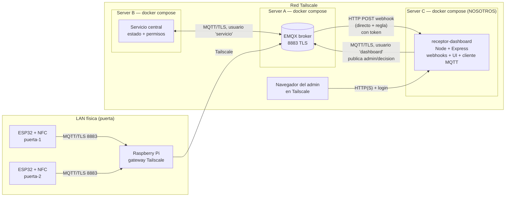

# Plan: receptor de webhooks + dashboard de admin

Proyecto 2 de Sistemas Distribuidos: control de acceso con NFC sobre MQTT.
Nuestra parte es el **requerimiento 6 (webhooks)** y el **dashboard del admin**.

> Entrega: **domingo 8/11** (repo + informe). Defensa: **jueves 12/11**.
> Desde la entrega el sistema tiene que quedar funcionando en los servidores.

---

## 0. Estado del repo (al 1/11) y qué le falta para nuestra parte

El repo ya tiene `compose-servidor-emqx.yaml` (EMQX + MySQL + phpMyAdmin) y `servicio-acceso/` (Python + paho + SQLite). El servicio escucha `puertas/+/solicitud` y responde en `puertas/{puerta}/respuesta` con `ACCESO_CONCEDIDO` o `ACCESO_DENEGADO`. **Adoptamos sus topics** (§3).

| Falta | Dónde | Por qué nos importa | Bloquea |
|---|---|---|---|
| Estado `ACCESO_PENDIENTE` (usuario conocido sin permiso para esa puerta) | `servicio.py` | Sin él, la regla A no tiene nada que mandar al dashboard | regla A, dashboard |
| `req_id` en solicitud y respuesta, deduplicación | ESP32 + `servicio.py` | QoS 1 puede duplicar; la decisión del admin necesita a qué solicitud referirse | regla A, decisión |
| Escuchar `admin/decision` + timeout de 45 s | `servicio.py` | Es el que decide; el dashboard solo sugiere | decisión |
| `nombre`, `puerta`, `via_admin`, `expira_en` en la respuesta | `servicio.py` | Lo que muestra el dashboard | regla A |
| `subscribe` dentro de `on_connect` | `servicio.py` | Hoy, si el broker se reinicia, el servicio se reconecta pero queda sin suscripción | req. 2 y 3 |
| Usuarios, ACL y TLS (8883) | EMQX | Sin ACL no hay denegaciones que detectar | regla B, usuario `dashboard` |
| Servicio apuntando a la IP de Tailscale del broker (hoy `host.docker.internal:1883`) | `servicio-acceso/compose.yaml` | El enunciado pide broker y servicio en servers distintos | despliegue |
| Fijar versión de EMQX (hoy `latest`) y quitar `admin/public` | compose + README | Seguridad y que la config sea reproducible | — |
| ¿Para qué está MySQL? El servicio usa SQLite | compose | Si no es para la autenticación de EMQX, sobra y expone 3307/8080 con claves débiles en el repo | — |

**A favor:** EMQX ya guarda `/opt/emqx/data` en el volumen `emqx_data`, así que el webhook y las reglas que creemos en el panel sobreviven si se recrea el container.

**Sin bloqueos podemos hacer ya:** el receptor (Fase 1), el webhook directo de connect/disconnect y la UI con datos falsos.

---

## 1. Qué hace el sistema

1. Una persona pasa una tarjeta NFC o el celular por un **ESP32** (lector NFC) en una puerta.
2. El ESP32 publica una **solicitud** por MQTT. Pasa por la Raspberry Pi y llega al broker por Tailscale.
3. El **servicio central** busca el permiso del usuario y responde:
   - **permitido**: la puerta se abre.
   - **denegado**: el usuario no existe o está bloqueado.
   - **pendiente**: el usuario existe, pero no tiene permiso para esa puerta. El ESP32 muestra "esperando admin".
4. Cuando una solicitud queda **pendiente**, al **dashboard** le llega una notificación (por un webhook disparado por una regla de EMQX). Ahí el admin hace clic en **Aceptar** o **Rechazar**.
5. El dashboard publica la decisión por MQTT. El servicio la valida y le responde a la puerta.
6. Si el admin no contesta en **N segundos** (proponemos 45 s), el servicio rechaza la solicitud solo.

**Regla de oro del enunciado:** ningún componente le habla directamente a otro. El dashboard **no** llama al servicio por HTTP. La notificación le llega desde el broker (webhook) y la decisión vuelve por MQTT.

---

## 2. Arquitectura



### Componentes

| Componente | Dónde corre | Quién lo hace | Habla con |
|---|---|---|---|
| EMQX | Server A, container | grupo | todos (es el broker) |
| Servicio central | Server B, container | otros integrantes | solo con EMQX (MQTT) |
| **receptor-dashboard** | **Server C, container** | **nosotros** | recibe HTTP **del broker**; publica MQTT **al broker**; sirve la UI al admin |
| ESP32 (×2 o más) | puertas | otros integrantes | EMQX, a través de la RPi |
| Raspberry Pi | LAN de las puertas | otros integrantes | puente de los ESP32 a Tailscale |

### Por qué en un server aparte
- El enunciado pide que el receptor sea "un servidor HTTP **externo**". En otro host se ve claro que el broker lo llama por la red.
- Si se cae el Server A (broker), el dashboard sigue arriba y muestra el historial. Y al revés: si se cae el dashboard, el broker acumula los avisos y los reintenta (ver §5).
- Costo: el webhook viaja por Tailscale en lugar de quedarse en la red interna de Docker. Tailscale ya cifra (WireGuard), y además autenticamos con un token (ver §6).

---

## 3. Topics (los del repo + lo que agregamos)

Seguimos los topics que ya usa `servicio-acceso`: `puertas/{puerta}/...`, con `{puerta}` = `puerta_hall`, `puerta_servidores`. El client ID de cada ESP32 es igual a su usuario MQTT y a `{puerta}`. Lo marcado *nuevo* hay que sumarlo al servicio.

| Topic | Publica | Se suscribe | QoS | Retained | Notas |
|---|---|---|---|---|---|
| `puertas/{puerta}/solicitud` | ESP32 (solo su puerta) | servicio: `puertas/+/solicitud` | 1 | no | hoy `{uid, puerta}`; *nuevo*: `req_id` único, el servicio deduplica |
| `puertas/{puerta}/respuesta` | servicio | ESP32 (solo su puerta) | 1 | no | `estado`: `ACCESO_CONCEDIDO` / `ACCESO_DENEGADO`; *nuevo*: `ACCESO_PENDIENTE` y `ACCESO_EXPIRADO` |
| `puertas/{puerta}/presencia` *nuevo* | ESP32 (LWT) | servicio | 1 | **sí** | `online` al conectar, `offline` como Last Will |
| `admin/decision` *nuevo* | **dashboard** | servicio | 1 | no | `{req_id, decision, admin}`; idempotente por `req_id` |
| `servicio/presencia` *nuevo* | servicio (LWT) | ESP32, dashboard | 1 | **sí** | si el servicio se cae, las puertas pasan a "fuera de servicio" |

**Payload de `respuesta` cuando queda pendiente** (lo que dispara la regla). Mantiene los campos actuales (`uid`, `estado`, `detalle`) y suma los nuevos:
```json
{ "req_id": "puerta_hall-1730300000-42", "uid": "A1B2C3D4", "estado": "ACCESO_PENDIENTE", "detalle": "Esperando al admin", "nombre": "Carlos Pérez (Empleado)", "puerta": "puerta_servidores", "expira_en": 45 }
```

**Cuándo es pendiente:** el `uid` existe en `usuarios` pero tiene `0` en la columna de esa puerta. Si el `uid` no existe, sigue siendo `ACCESO_DENEGADO` directo (no molestamos al admin con tarjetas desconocidas).

**Por qué QoS 1 y no 2:** un duplicado no rompe nada porque todo lleva `req_id`. El servicio ignora una solicitud o una decisión que ya procesó, y el dashboard ignora un aviso que ya guardó.

---

## 4. Webhooks (requerimiento 6)

### 4.1 Webhook directo: presencia de dispositivos
- **Dónde:** panel de EMQX → Integración → Webhook.
- **Disparador:** eventos `client.connected` y `client.disconnected`. No mira el contenido de ningún mensaje.
- **Destino:** `POST http://<ip-tailscale-server-C>:3000/webhook/eventos`.
- **Uso en el dashboard:** tabla "Dispositivos" (qué ESP32 y servicios están conectados) y log de conexiones y desconexiones con el motivo (`reason`).
- **Por qué este camino:** es un aviso por evento que no necesita filtrar ni transformar nada.

### 4.2 Webhook por regla A: solicitudes pendientes (el núcleo de la temática)
- **Dónde:** Integración → Reglas, con acción "HTTP Server".
- **SQL:**
  ```sql
  SELECT
    payload.req_id    as req_id,
    payload.nombre    as nombre,
    payload.uid       as uid,
    payload.puerta    as puerta,
    payload.estado    as estado,
    payload.expira_en as expira_en,
    timestamp         as ts
  FROM "puertas/+/respuesta"
  WHERE payload.estado = 'ACCESO_PENDIENTE'
     OR payload.via_admin = true
  ```
  `via_admin = true` lo agrega el servicio a la respuesta final de una solicitud que pasó por el admin (aceptada, rechazada o expirada). Así el dashboard se entera de cómo terminó y desactiva los botones.
- **Destino:** `POST /webhook/reglas/pendientes`.
- **Por qué con regla:** solo interesa una fracción de los mensajes de `respuesta` (las pendientes), y la regla además arma un JSON chico con lo justo.

### 4.3 Webhook por regla B: intentos de trampa (seguridad)
- **SQL:**
  ```sql
  SELECT clientid, username, topic, action, result, peerhost, timestamp as ts
  FROM "$events/client_check_authz_complete"
  WHERE result = 'deny'
  ```
- **Destino:** `POST /webhook/reglas/alertas`.
- **Uso:** panel "Alertas de seguridad". Sirve para la defensa: un cliente tramposo que intenta publicar en la puerta de otro o en `admin/decision` aparece en vivo en el dashboard.

> ⚠️ Verificar en nuestra versión de EMQX los nombres exactos del evento (`$events/client_check_authz_complete` en 5.x) y de los campos.

---

## 5. ¿Qué hace el broker si el receptor está caído?

El conector HTTP de EMQX tiene un **buffer**. Mientras el receptor no responde, encola los pedidos y los reintenta según `resource_opts` (`request_ttl`, tamaño del buffer, `health_check_interval`). Cuando el receptor vuelve, los avisos encolados llegan.

- El conector queda en estado *disconnected* en el panel. Lo mostramos en la defensa: paramos el container del dashboard, pasamos una tarjeta y lo volvemos a levantar.
- Si el aviso expira en el buffer (pasa el TTL), se pierde **solo la notificación**. El estado real vive en el servicio, y la solicitud pendiente expira sola y se rechaza.
- Un reintento puede entregar el mismo aviso dos veces, así que el receptor deduplica por `req_id` (pendientes) y por `clientid + ts` (eventos).

---

## 6. Seguridad de nuestra parte

| Riesgo | Medida |
|---|---|
| Alguien que no es el broker manda webhooks falsos | El broker manda el header `Authorization: Bearer <WEBHOOK_TOKEN>` (se configura en el conector). El receptor lo compara con `crypto.timingSafeEqual` y si no coincide responde **401**. Además el puerto solo escucha en la IP de Tailscale. |
| Alguien entra al dashboard y aprueba accesos | Login con usuario y clave del admin (desde `.env`, nunca `admin/admin`) y cookie de sesión. El puerto solo escucha en la IP de Tailscale. Opcional: HTTPS con `tailscale serve`. |
| El dashboard publica cosas que no debe | Usuario MQTT `dashboard` con ACL: **publish solo en `admin/decision`** y **subscribe solo en `servicio/presencia`**. Client ID atado al usuario. Se conecta por TLS (8883) validando nuestra CA. |
| El admin aprueba algo que ya expiró o se aprueba dos veces | Decide el **servicio**, no el dashboard: ignora decisiones de un `req_id` ya cerrado. El dashboard solo sugiere. |
| Secretos en el repo | `.env` y certificados en `.gitignore`. Se sube un `.env.example`. |

---

## 7. Persistencia y despliegue

### Nuestro container (Server C)
```yaml
# compose.yaml (server C)
services:
  receptor-dashboard:
    build: .
    restart: unless-stopped
    env_file: .env
    ports:
      - "${TAILSCALE_IP}:3000:3000"   # solo en la interfaz de Tailscale
    volumes:
      - dashboard-data:/app/data      # log de eventos (JSONL)
      - ./certs/ca.crt:/app/certs/ca.crt:ro
volumes:
  dashboard-data:
```

`.env` (ejemplo):
```
TAILSCALE_IP=100.x.y.z
WEBHOOK_TOKEN=...
ADMIN_USER=...
ADMIN_PASSWORD=...
MQTT_URL=mqtts://<ip-tailscale-server-A>:8883
MQTT_USER=dashboard
MQTT_PASSWORD=...
```

### ¿El webhook y las reglas sobreviven si se borra el container de EMQX?
Si se crean **a mano desde el panel**, se guardan en `/opt/emqx/data/configs/cluster.hocon`. Sobreviven **solo si `/opt/emqx/data` es un volumen**. Para no depender de eso:
- **Plan:** declarar conector, acciones y reglas en un archivo de config que esté en el repo y se monte en el container de EMQX (o crearlos con un script que llame a la API REST de EMQX después de levantar). El token se inyecta por variable de entorno.
- Probar en la defensa: `docker compose down`, `docker rm`, `docker compose up -d`, y el webhook y las reglas siguen ahí.

### ¿Se pierde el estado del dashboard?
No. Cada aviso recibido se agrega a `data/eventos.jsonl` (en el volumen) y se recarga al arrancar. La fuente de verdad de los permisos sigue siendo el servicio.

---

## 8. Diseño del receptor-dashboard (Node + Express)

Dependencias del servidor: `express` y `mqtt`. La UI es una app **React con Vite** en `backend-dashboard/web/`: se compila dentro del Dockerfile (build en dos etapas) y Express sirve `web/dist`, así que sigue siendo un solo container. La actualización en vivo va por SSE (`EventSource`, nativo del navegador). Sin Next.js, sin Nginx y sin librerías de estado. En desarrollo, Vite reenvía `/api`, `/stream` y `/login` al Express.

| Ruta | Quién la llama | Qué hace |
|---|---|---|
| `POST /webhook/eventos` | EMQX (webhook directo) | verifica el token, guarda el evento, actualiza la tabla de dispositivos y lo emite por SSE |
| `POST /webhook/reglas/pendientes` | EMQX (regla A) | verifica el token, deduplica por `req_id`, guarda y lo emite por SSE |
| `POST /webhook/reglas/alertas` | EMQX (regla B) | verifica el token, guarda y lo emite por SSE |
| `GET /` | admin | app React compilada (`web/dist`); los datos piden login |
| `GET /stream` | navegador | SSE con los avisos en vivo |
| `POST /api/decision` | navegador | publica `{req_id, decision, admin}` en `admin/decision` (QoS 1) |
| `POST /login`, `POST /logout` | admin | sesión |

Vistas de la página:
1. **Solicitudes pendientes:** tarjeta con usuario, puerta, cuenta regresiva, y botones **Aceptar** / **Rechazar**. Cuando llega la respuesta final (`via_admin`), se marca como resuelta.
2. **Dispositivos:** quién está online u offline (del webhook directo).
3. **Alertas de seguridad:** ACL denegada (regla B).
4. **Log crudo:** todo lo que llegó, para mostrar en la defensa que "lo que recibe se puede ver".

---

## 9. Plan de trabajo

### Fase 0: acordar con el grupo (hoy / mañana)
- [ ] Acordar con quien hizo `servicio-acceso` los cambios de §0: `ACCESO_PENDIENTE`, `req_id`, `admin/decision`, timeout y los campos nuevos de la respuesta. Decidir si los hace esa persona o nosotros.
- [ ] Avisar del bug del `subscribe` fuera de `on_connect`.
- [ ] Preguntar para qué está MySQL en el compose del broker.
- [ ] Confirmar qué server es A, B y C, y sus IPs de Tailscale.
- [ ] Confirmar la versión de EMQX (5.x) y quién genera la CA y los certificados.
- [ ] Pedir el usuario MQTT `dashboard` y su regla de ACL a quien configura EMQX.

### Fase 1: receptor mínimo (día 1-2)
- [x] `package.json`, `index.js` y `routes/webhooks.js` con Express y las 3 rutas de webhook con verificación del token.
- [x] Persistencia en `data/eventos.jsonl` y recarga al arrancar.
- [x] `Dockerfile` y `compose.yaml` con `restart: unless-stopped` y el volumen.
- [x] Probar con `curl` (con y sin token: 200 y 401).

### Fase 2: webhooks en EMQX (día 2-3)
- [ ] Crear el conector HTTP con el header `Authorization`.
- [ ] Webhook directo (connect y disconnect) y verificar que llega.
- [ ] Regla A (pendientes) y probar publicando a mano una `respuesta` con `estado=pendiente`.
- [ ] Regla B (authz deny) y probar publicando en un topic prohibido.
- [ ] Pasar todo a config versionada o a un script de API, y probar borrar y recrear el container de EMQX.

### Fase 3: dashboard (día 3-5)
- [ ] Login de admin.
- [ ] App React con las 4 vistas y SSE, compilada en el Dockerfile.
- [ ] Cliente MQTT por TLS que publica `admin/decision`.
- [ ] Prueba de punta a punta con el servicio real: tarjeta sin permiso → aparece en el dashboard → Aceptar → se abre la puerta.

### Fase 4: pruebas de falla y defensa (día 5-7)
- [ ] Receptor caído: el broker encola y entrega cuando vuelve.
- [ ] Webhook falso desde otra máquina: responde 401 y no se muestra.
- [ ] Cliente tramposo que publica en `admin/decision` con otro usuario: ACL deny y aparece en alertas.
- [ ] Doble clic o dos admins: solo cuenta la primera decisión (lo garantiza el servicio).
- [ ] Timeout: el admin no responde y la solicitud expira.

### Fase 5: informe (en paralelo)
- [ ] Sección del req. 6: por qué cada aviso va por su camino, qué pasa si el receptor cae, cómo se autentica el broker y persistencia de la config.
- [ ] Capturas del dashboard y del panel de EMQX.
- [ ] README: comandos exactos para levantar el Server C.

---

## 10. Preguntas abiertas

- ¿El servicio necesita saber **qué admin** decidió (para auditoría)? Por ahora mandamos el nombre en el payload.
- ¿Timeout de 45 s? Depende de cuánto tiempo puede esperar el ESP32 con la persona en la puerta.
- ¿El dashboard también debería poder **dar permisos permanentes**? Quedó fuera del alcance (solo "abrir ahora"). Si se suma, sería otro topic (`admin/permisos`) y lo valida el servicio.
- **Log crudo en el dashboard (por confirmar):** ¿la vista "Log crudo" va sí o sí? Si va, falta exponer los avisos tal como llegaron (`eventos.jsonl`), con límite y detrás del login. `estado.js` hoy no lo arma.
- Celular como NFC: Android necesita una app con HCE, y el UID que expone no es fijo, así que hay que identificar por AID y token. Lo resuelven quienes hacen el ESP32, pero conviene que el payload de `solicitud` no dependa solo de `uid`.
